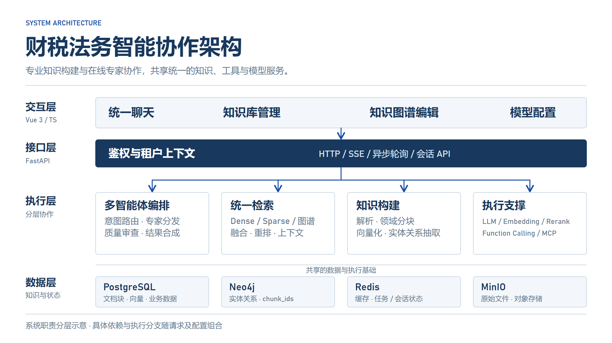
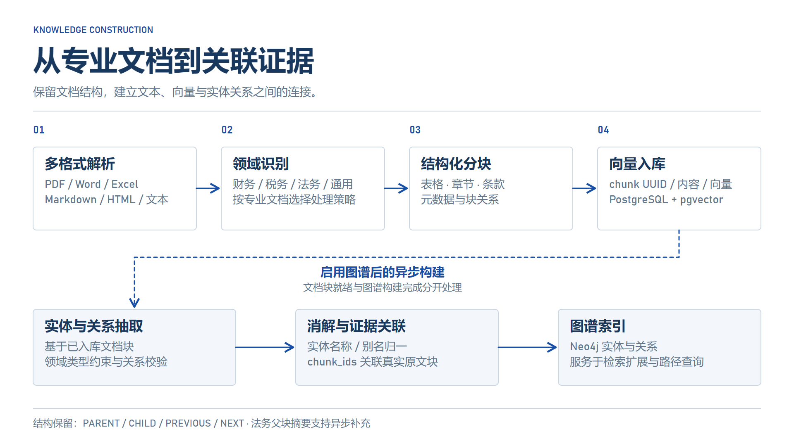
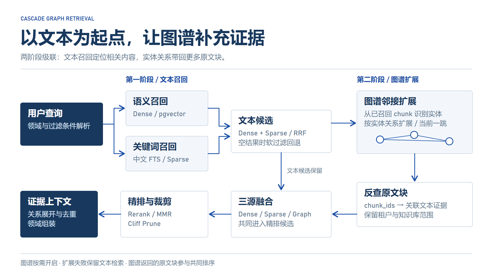
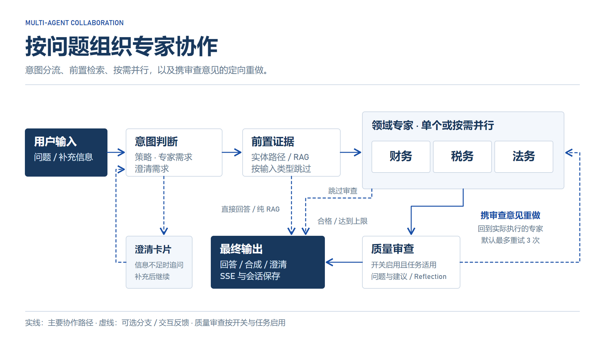

# 财税法务智能协作 Agent

<div align="center">


**级联 GraphRAG · 多专家 LangGraph 协作 · 领域感知知识构建 · 审查驱动重做**

让财报、政策与合同成为专家协作的知识底座

[项目概述](#overview) · [设计亮点](#highlights) · [系统架构](#architecture) · [知识构建](#ingestion) · [检索设计](#retrieval) · [专家协作](#collaboration) · [工程实践](#practice) · [评估](#evaluation) · [部署](#deployment)

</div>

---

<a id="overview"></a>

## 📋 项目概述

本项目是一套**面向财务、税务与法务场景的 RAG（Retrieval-Augmented Generation）知识库与多智能体协作平台**，采用 **FastAPI + Vue 3** 前后端分离架构，将专业文档处理、级联图谱检索、领域专家与质量审查组织为完整的任务流程。

财报中的数字需要回到表格，政策问题需要定位条款，跨领域风险需要不同专家共同判断。系统将这些材料转为带结构和实体关联的知识：**向量与中文全文检索定位文本，图谱沿实体关系补充原文证据，LangGraph 按任务分发给财务、税务和法务专家**。专家结合证据与工具完成分析，信息不足时通过澄清卡片补全任务，适用的专家任务进入质量审查与定向重做。

平台覆盖从文档上传到专家回答的两条核心链路，并提供模型配置、图谱编辑、工具注册、租户上下文和会话历史等配套能力。

### 核心能力矩阵

| 能力维度 | 技术实现 | 核心能力 |
|----------|----------|----------|
| **专业文档处理** | 解析器工厂 + 领域路由 + 结构化分块 | PDF、Word、Excel、Markdown、HTML、文本与图片解析；保留表格、条款和章节结构 |
| **混合检索** | pgvector + jieba/FTS + RRF + Rerank | 并行文本召回、图谱候选融合、软过滤回退与上下文组织 |
| **级联 GraphRAG** | Neo4j + 实体消解 + `chunk_ids` 桥接 | 文本定位种子实体，沿图谱扩展并反查原文，新增证据共同参与精排 |
| **专家协作** | LangGraph StateGraph + 原生 Function Calling | 按意图选择单专家或多专家并行，结合知识证据和工具完成领域分析 |
| **交互与审查** | 结构化澄清 + Reflection + SSE | 任务补充、实时阶段与文本输出、具体审查意见驱动有界重做 |
| **平台基础** | 模型适配器 + MCP + 多租户上下文 | 模型配置、工具调用、企业知识管理与会话历史 |

---

<a id="highlights"></a>

## 🎯 设计亮点 — 为什么这样设计

| 设计选择 | 技术方案 | 设计意图与取舍 |
|----------|----------|----------------|
| **图谱与文本结合** | 文本召回 → 实体扩展 → 反查原文块 | 从候选文本确定实体锚点，让关系扩展落回可引用的原文证据 |
| **召回与精排分层** | Dense + Sparse → RRF → 图谱融合 → Rerank | 语义匹配、关键词匹配和实体关联互补，所有候选统一精排与裁剪 |
| **领域感知分块** | 财务 / 税务 / 法务 / 通用策略 | 以表格、条款和章节为知识单元，通过父子与相邻关系补充检索上下文 |
| **编排与执行分层** | LangGraph 状态机 + 专家工具循环 | 共享状态协调任务流向，领域专家保留分析与工具调用的自主性 |
| **语义路由与规则配合** | 规则速通/降级 + LLM 语义决策 | 在意图分类中同时判断协作策略、专家需求与澄清需求，简单交互保留快速路径 |
| **审查驱动重做** | 审查意见 → 实际执行专家 → 重新回答 | 以具体问题和建议指导下一轮分析，重试上限控制时延与模型调用成本 |
| **结构化交互** | 后端返回澄清数据，前端渲染卡片 | 将追问内容与展示方式分开，便于补充信息后继续任务 |

---

<a id="architecture"></a>

## 🏗️ 系统架构

### 整体架构图



<details>
<summary>查看矢量源图</summary>

[SVG](docs/assets/figures/system-architecture.svg)

</details>

### 两条核心链路

- **知识构建链路**：将文档转换为带结构、元数据和实体关联的知识，供后续检索使用。
- **在线问答链路**：理解用户意图，获取证据，选择专家并执行分析，再合成回答。

模型适配、工具注册、租户上下文和会话管理为两条链路提供公共能力。业务模块通过共享状态与统一检索接口协作，执行分支由请求类型和运行配置决定。

### 编排层与专家执行层

| 层次 | 核心组件 | 职责 |
|------|----------|------|
| **编排层** | `AgentOrchestrator` + LangGraph `StateGraph` | 管理共享状态、前置检索、专家分发、审查与结果输出 |
| **专家执行层** | `BaseSpecialistAgent` 及领域专家 | 在领域提示词和上下文下分析问题，处理结构化 `tool_calls` 和多轮工具调用 |
| **独立 Agent 框架** | `agent_framework` 中的 ReAct / Plan / Reflect | 为其他 Agent 场景提供执行框架；与默认多智能体入口分别组织工作流 |

专家采用原生 Function Calling：以 `tools` 提供工具定义，以结构化 `tool_calls` 返回调用请求，并支持多轮工具执行。独立 `ReActAgent` 使用另一套执行工作流，保留文本协议路径。

> 代码入口：[多智能体编排器](rag_backend/app/multi_agent_system/orchestrator.py) · [专家基类](rag_backend/app/multi_agent_system/agents/base_specialist.py) · [Agent 框架](rag_backend/app/agent_framework)

---

<a id="ingestion"></a>

## 📚 知识构建 — 从专业文档到可检索证据

### 文档入库流程



<details>
<summary>查看矢量源图</summary>

[SVG](docs/assets/figures/knowledge-ingestion.svg)

</details>

解析器工厂根据文件类型选择处理策略。目前注册了 PDF、Word、Excel、Markdown、HTML、文本与图片七类解析器。图谱构建在功能开启且入库没有前置错误时异步触发，通过桥接模块关联真实的 chunk UUID；文档块就绪与图谱构建完成是两个阶段。

### 领域感知分块

`DomainDetector` 根据用户指定领域、文件名线索和模型判断选择处理策略。分块器围绕专业文档中的表格、条款和章节建立知识单元，并通过 `PARENT / CHILD / PREVIOUS / NEXT` 等关系连接上下文。

| 领域 | 主要策略 | 保留的信息 |
|------|----------|------------|
| **财务** | `FinancialChunker` | 表格、财务指标，以及表格与正文的关联 |
| **税务** | `TaxChunker` | 政策条款、时效元数据与相邻条款关系 |
| **法务** | `LegalChunker` | 章节父块、条款叶块、父块摘要与上下文关系 |
| **通用** | `GeneralChunker` | 细粒度召回与粗粒度上下文，支持 Auto-Merging |
| **补充策略** | Adaptive / Proposition 等分块器 | 语义边界、原子命题与基础格式处理 |

### 图谱与原文的桥接

`KGIngestBridge` 从文档块抽取实体与关系，再使用实体消解模块处理别名与重复名称，统一关系端点。实体节点保存关联文档块的 `chunk_ids`，形成检索阶段所需的桥接关系：

```text
原文块（UUID） ↔ 实体 ↔ 实体关系 ↔ 其他实体 ↔ 关联原文块（UUID）
```

**设计价值**：图谱提供关联线索，原文块提供回答证据。两者通过稳定的标识连接，检索结果可以回到具体文本，而不只返回实体名称或关系描述。

块关系通过文档内索引定位，父块摘要按真实 UUID 回写，支持检索阶段展开父块和相邻条款。实体名称与原文匹配建立图谱桥接，因此实体消解和文档覆盖质量是扩展效果的关键。

> 代码入口：[入库 API](rag_backend/app/api/v1/endpoints/knowledge.py) · [解析器工厂](rag_backend/app/parsers/parser_factory.py) · [分块器](rag_backend/app/chunkers) · [图谱入库桥接](rag_backend/app/knowledge_graph/ingest_bridge.py) · [实体消解](rag_backend/app/knowledge_graph/entity_dedup.py)

---

<a id="retrieval"></a>

## 🔎 检索设计 — 混合召回与级联 GraphRAG

### 两阶段级联检索

统一检索器先执行文本召回，再从召回结果出发扩展图谱。图谱召回的文档块在精排之前进入候选集合，与文本召回结果共同排序。



<details>
<summary>查看矢量源图</summary>

[SVG](docs/assets/figures/cascade-retrieval.svg)

</details>

图谱扩展由 `enable_graph` 与服务配置控制；关闭图谱或扩展失败时，保留文本检索链路。种子实体优先来自已召回文本，必要时回退到查询本身；当前主级联使用 `max_depth=1` 的邻接扩展。

### 为什么从召回文本出发

用户提问未必包含完整实体名称。例如，“这家公司一季度的研发投入有什么变化？”中的实体需要结合文档才能确定。先利用文本召回找到候选证据，再从文本中识别实体，可以为图谱扩展提供更具体的起点。

图谱带回的 chunk 与文本候选通过 RRF 融合，共同参与重排。统一检索器输出原文证据和图谱上下文，供不同问答入口组织模型输入。

### 检索正确性与上下文控制

| 环节 | 当前处理 | 解决的问题 |
|------|----------|------------|
| **中文稀疏检索** | 应用层 jieba 分词 + PostgreSQL `tsvector` 全文检索 | 改善中文文本缺少分词时的关键词召回；代码中归入 BM25/稀疏检索链路 |
| **软过滤回退** | 严格过滤为空时，逐步放宽季度、地域、税种、年份等推断条件 | 元数据缺失或推断过严时，避免候选被全部清空 |
| **知识范围过滤** | 文本与图谱反查都传递租户和知识库条件 | 图谱扩展应遵循调用方的检索范围；多智能体入口当前按租户检索，`kb_id=None` |
| **融合与精排** | RRF、重排、MMR 与 Cliff Prune | 兼顾召回覆盖、相关性和重复控制；部分步骤由配置决定 |
| **关系展开** | 父块摘要与相邻文档块补充 | 补齐单个细粒度 chunk 的解释上下文 |
| **领域组装** | 时序去重、通用领域 Auto-Merging、领域提示词组装 | 按文档结构和领域组织证据，控制上下文规模 |

软回退放宽的是推断出的业务元数据条件，仍保留传入的租户与知识库范围。更宽的候选范围可能带来噪声，需要后续排序和上下文组织配合。

### 两种图谱使用方式

| 方式 | 所在位置 | 主要职责 |
|------|----------|----------|
| **级联图谱扩展** | `UnifiedRetriever` | 从文本候选出发扩展实体，通过 `chunk_ids` 增加原文证据 |
| **实体路径检索** | 多智能体 `graph_path_retrieval` 节点 | 对可识别实体对尝试路径查询，为专家提供关系上下文；无适用实体或查询失败时跳过 |

默认多智能体以级联返回的文本 chunk 作为证据，通过独立实体路径节点补充关系摘要。统一检索器的完整图谱上下文由具体入口消费；两条路径分别承担原文召回与关系上下文组织。

### 独立 Agentic 检索分支

独立 Agentic RAG 分支将检索组织为**规划 → 检索 → 评估 → 改写或升级 → 聚合**。规划器按轮决定图谱使用，改写后仍低覆盖时可升级到 `graph_traverse`；止损判断保留升级机会，让低覆盖查询有机会调整检索方式。

Agentic RAG 与默认多智能体编排分别组织工作流。独立 Agent 工作流还包含 CRAG 与忠实度校验等节点，可按场景选择相应入口。

> 代码入口：[统一检索器](rag_backend/app/services/unified_retriever.py) · [混合检索](rag_backend/app/services/hybrid_search.py) · [中文 FTS](rag_backend/app/utils/chinese_fts.py) · [上下文组装](rag_backend/app/services/context_assembler.py) · [Agentic 检索节点](rag_backend/app/langgraph/agentic_rag_nodes.py)

---

<a id="collaboration"></a>

## 🤖 多智能体协作 — 从意图到专业回答

### 统一入口与任务状态机

前端 `/` 为统一多智能体聊天入口，默认调用 `/api/v1/multi-agent/query-stream`。后端通过 `process_user_request()` 执行 LangGraph，SSE 包装阶段进度与文本输出；异步轮询回退也复用该执行入口。



<details>
<summary>查看矢量源图</summary>

[SVG](docs/assets/figures/expert-collaboration.svg)

</details>

状态机按任务分流：问候、澄清和元问题跳过不需要的检索，知识库问答直接生成答案，单专家与多专家任务结合证据执行分析。适用的专家任务按开关进入审查，元问题跳过审查。

### 意图判断与协作策略

`IntentRouterAgent` 输出意图、路由策略、所需专家和澄清请求。规则为问候等简单输入提供速通，高置信度规则结果仍可跳过 LLM；其他输入由 LLM 补充语义判断，失败时保留规则降级。

LLM 在意图分类中同时输出 `routing_strategy`、`requires_specialists` 和 `needs_clarification`，为任务选择协作方式与领域专家。澄清围绕任务所缺的信息展开，分类置信度不单独作为追问依据；规则保留速通与降级职责。

| 路由结果 | 后续行为 |
|----------|----------|
| **直接回答** | 处理问候、简单交互与可直接回复的内容 |
| **结构化澄清** | 返回追问数据，前端以卡片收集补充信息后继续 |
| **知识库问答** | 使用前置检索证据生成回答 |
| **单专家** | 将证据与任务交给对应领域专家 |
| **多专家** | 财务、税务、法务专家按需求并行执行，合成结果 |

### 共享上下文与专家执行

LangGraph 使用共享状态传递用户问题、检索证据、图谱路径上下文、专家结果和审查意见。前置 RAG 使专家在分析前获得知识库证据，各专家再结合领域提示词与工具完成任务。

专家层支持原生 Function Calling 和多轮工具循环；多个工具调用可以并行执行。模型选择、可用工具和工具能力由适配器、配置与注册机制共同决定。

### 质量审查与有界重做

启用 Reflection 后，系统评估专家输出并生成问题与建议。需要重做时，审查意见进入专家的新一轮输入，任务返回实际执行过的领域专家，减少领域错配和无针对性的重复生成。

状态机默认最多重试 **3 次**，达到上限后进入最终输出。审查意见包含具体问题与改进建议，重试回到实际执行过的专家，并将意见注入下一轮输入，形成有界的质量改进循环。

### 前端如何呈现执行过程

| 交互 | 当前实现 |
|------|----------|
| **统一聊天** | `/` 默认进入多智能体页；经典聊天保留在 `/classic-chat` |
| **过程展示** | 将路由、专家、反思等阶段转为可读标签，并展示专家输出 |
| **澄清卡片** | 后端返回结构化追问，`ClarificationCard` 负责渲染与提交 |
| **会话管理** | 加载、删除和清空历史，切换会话时重置过程面板 |
| **输出链路** | 处理阶段事件与文本增量，避免后处理静默截断完整回答 |

> 代码入口：[多智能体 API](rag_backend/app/api/v1/endpoints/multi_agent.py) · [意图路由](rag_backend/app/multi_agent_system/agents/intent_router_agent.py) · [编排器](rag_backend/app/multi_agent_system/orchestrator.py) · [统一聊天页面](rag_frontend/src/views/MultiAgentChatView.vue) · [澄清卡片](rag_frontend/src/components/ClarificationCard.vue)

---

<a id="practice"></a>

## 🛠️ 核心工程实践

围绕“知识能检索、证据能关联、任务能协作、结果能检查”，系统将检索质量、上下文结构与执行可靠性落到以下工程环节：

| 工程实践 | 实现方式 | 价值 |
|----------|----------|------|
| **三源候选融合** | 文本召回后级联图谱，反查 chunk 并在精排前进入 RRF | 将语义、关键词与实体关联组织为统一候选集合 |
| **中文检索与范围控制** | jieba 分词、FTS 索引、软过滤回退、租户与知识范围传递 | 兼顾中文召回、缺失元数据与检索范围 |
| **文档结构贯通** | 块关系索引、父块定位、摘要 UUID 回写与 Auto-Merging | 将细粒度匹配展开为可理解的段落与条款上下文 |
| **政策网页入库** | HTML 结构化解析并接入解析工厂 | 将政策网页与 PDF、Word 等材料纳入同一知识构建流程 |
| **Agentic 检索调度** | 按轮规划图谱使用，低覆盖时改写或升级检索方式 | 根据证据覆盖情况调整下一轮检索动作 |
| **语义路由与澄清** | 意图分类统一输出策略、专家需求与结构化追问 | 让专家协作方式与用户实际任务对应 |
| **审查与输出可靠性** | 审查意见回传原专家，保留代码块与 JSON 包装中的正文 | 支持定向重做，减少输出组装过程中的内容损失 |
| **统一交互与过程展示** | SSE、异步轮询、澄清卡片、中文阶段标签与历史管理 | 将任务进度、专家执行和审查结果呈现给用户 |

<details>
<summary>🧩 模型、工具与平台能力（点击展开）</summary>

- **模型适配与配置**：LLM 工厂、领域专家模型路由、Embedding 与 Rerank 配置，支持 DeepSeek、OpenAI、Claude、智谱、Qwen 等适配路径。
- **工具与技能**：MCP 工具注册、领域工具、原生工具调用，以及独立 Agent 框架中的技能加载机制。
- **知识与图谱管理**：知识库管理、文件上传、图谱查询和可视化编辑。
- **平台管理**：多租户上下文、角色权限、企业与会话管理、人工审核相关模块。
- **上下文管理**：专家上下文优化、记忆模块和 Token 预算等公共能力。

模型适配器、工具注册和运行配置共同决定各场景的可用能力。

</details>

---

<a id="evaluation"></a>

## 🧪 评估与验证

### 级联 GraphRAG 消融实验

在 **2026-10-04** 的实验中，使用同一知识库、同一批 **13 道题（FIN 3 + LEG 10）**，仅切换 `enable_graph`，比较级联图谱与 Dense + BM25 混合检索的表现。

| 指标 | 开启级联图谱 | 关闭图谱 | 差值 |
|------|--------------|----------|------|
| **Context Precision** | **0.806** | 0.641 | **+0.164** |
| **Context Recall** | **0.846** | 0.692 | **+0.154** |
| **Faithfulness** | **0.930** | 0.908 | +0.022 |

<sub>差值按未舍入的逐题均值计算，表内指标保留三位小数。</sub>

图谱带来的召回收益主要集中于 3 道 FIN 题，帮助查询定位到正确财报的原文块；LEG 的 Recall 两组均为 0.900。实验展示了实体关联对特定检索场景的补充价值，后续将扩展题目与领域覆盖。

<details>
<summary>📐 实验设置与复现说明（点击展开）</summary>

- **数据范围**：13 道财务与法务题，知识库包含 11 份文档；TAX 的 5 道题未纳入本次实验。
- **模型配置**：生成器与裁判均为 DeepSeek，Embedding 为 `BAAI/bge-m3`；后续评估计划引入不同裁判模型。
- **实验口径**：两组仅切换图谱开关，关闭图谱的一组仍执行 Dense + BM25；结果描述该样本集的表现。
- **评估产物**：逐题分数已保存为 CSV，`run_ours.py` 提供 RAGAS 打分；检索与回答生成脚本 `run_eval.py` 待整理入库。

</details>

> 实验报告与逐题结果：[级联评估报告](rag_backend/tests/evaluators/EVAL_REPORT_cascade.md) · [开启图谱 CSV](rag_backend/tests/evaluators/ragas_ours_graph.csv) · [关闭图谱 CSV](rag_backend/tests/evaluators/ragas_ours_nograph.csv)

### 回归验证

测试围绕路由策略、检索不变量、澄清交互和输出完整性组织，覆盖已知事实检索、中文关键词召回、图谱检索上下文、父块摘要、多轮检索升级及答案组装等环节。详见[后端测试目录](rag_backend/tests)；集成与冒烟用例需要相应的数据库、模型与文档数据。

### 后续计划

- 补齐评估生成脚本与 TAX 数据，扩大样本覆盖并引入不同裁判模型。
- 优化实体消解、图谱关联与知识范围选择。
- 完善数据库初始化与不同模型、工具配置下的验证流程。

---

<a id="deployment"></a>

## 🚀 启动与部署

详细步骤已集中到 **[部署指南](docs/DEPLOYMENT.md)**，涵盖环境配置、源码构建、数据库准备、前端启动与常见问题。

### 获取代码

在 PowerShell 7 中执行：

```powershell
$ErrorActionPreference = 'Stop'
git clone https://github.com/q1480371991/tax-legal-agent.git
if ($LASTEXITCODE -ne 0) { throw '克隆仓库失败' }
Set-Location tax-legal-agent
```

### 启动步骤概览

1. 根据 `.env.example` 配置数据库、存储、对话模型与 Embedding；容器内地址按部署指南调整。
2. 准备兼容的数据库结构与必要数据，再通过 Docker Compose 从本仓库源码构建后端。
3. 在 `rag_frontend` 安装依赖并启动前端，登录后配置模型、上传知识文档。
4. 检查文档解析、向量与图谱构建状态，再从统一聊天入口发起任务。

| 入口 | 默认地址 / 路径 |
|------|-----------------|
| **前端开发服务** | `http://localhost:5500` |
| **后端 API 文档** | `http://localhost:8000/docs` |
| **统一聊天** | `/` |
| **经典聊天** | `/classic-chat` |
| **模型配置** | `/settings/models` |
| **图谱编辑** | `/knowledge-graph-editor` |

使用本仓库的 Docker Compose 从源码构建后端。数据库初始化、容器地址与模型配置的完整说明见部署指南。

---

<a id="code-navigation"></a>

## 📁 项目结构与代码导航

```text
tax-legal-agent/
├── rag_backend/
│   ├── app/
│   │   ├── api/v1/endpoints/       # 知识入库、多智能体与平台 API
│   │   ├── multi_agent_system/    # 路由、领域专家、LangGraph 编排
│   │   ├── services/              # 统一检索、融合、重排、上下文组装
│   │   ├── knowledge_graph/       # 实体关系抽取、消解与入库桥接
│   │   ├── parsers/               # 多格式结构化解析
│   │   ├── chunkers/              # 领域分块与块关系
│   │   ├── langgraph/             # 独立 Agent / Agentic RAG 工作流
│   │   ├── agent_framework/       # Agent 执行、模型、工具与技能框架
│   │   └── memory_system/         # 记忆与上下文模块
│   ├── tests/                    # 回归、集成与评估记录
│   └── docker-compose.yml
├── rag_frontend/                  # Vue 3 + TypeScript
├── mcp_server/                    # MCP 工具服务
├── docs/
│   ├── DEPLOYMENT.md              # 部署与配置指南
│   └── assets/figures/            # PNG 架构图与 SVG 源图
└── 530.sql                        # 数据库结构快照
```

| 阅读目标 | 建议入口 |
|----------|----------|
| **理解默认请求流程** | [多智能体 API](rag_backend/app/api/v1/endpoints/multi_agent.py) → [编排器](rag_backend/app/multi_agent_system/orchestrator.py) |
| **理解路由决策** | [IntentRouterAgent](rag_backend/app/multi_agent_system/agents/intent_router_agent.py) |
| **理解级联检索** | [UnifiedRetriever](rag_backend/app/services/unified_retriever.py) → [Hybrid Search](rag_backend/app/services/hybrid_search.py) |
| **理解入库与图谱桥接** | [知识 API](rag_backend/app/api/v1/endpoints/knowledge.py) → [KGIngestBridge](rag_backend/app/knowledge_graph/ingest_bridge.py) |
| **理解前端交互** | [MultiAgentChatView](rag_frontend/src/views/MultiAgentChatView.vue) → [ClarificationCard](rag_frontend/src/components/ClarificationCard.vue) |
| **查看评估证据** | [EVAL_REPORT_cascade](rag_backend/tests/evaluators/EVAL_REPORT_cascade.md) |

---

<a id="contact"></a>

## 📬 项目交流

- **项目仓库**：[q1480371991/tax-legal-agent](https://github.com/q1480371991/tax-legal-agent)
- **问题与建议**：[GitHub Issues](https://github.com/q1480371991/tax-legal-agent/issues)
